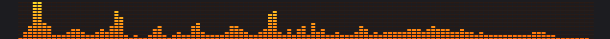
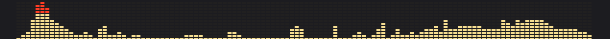
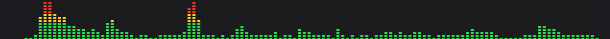
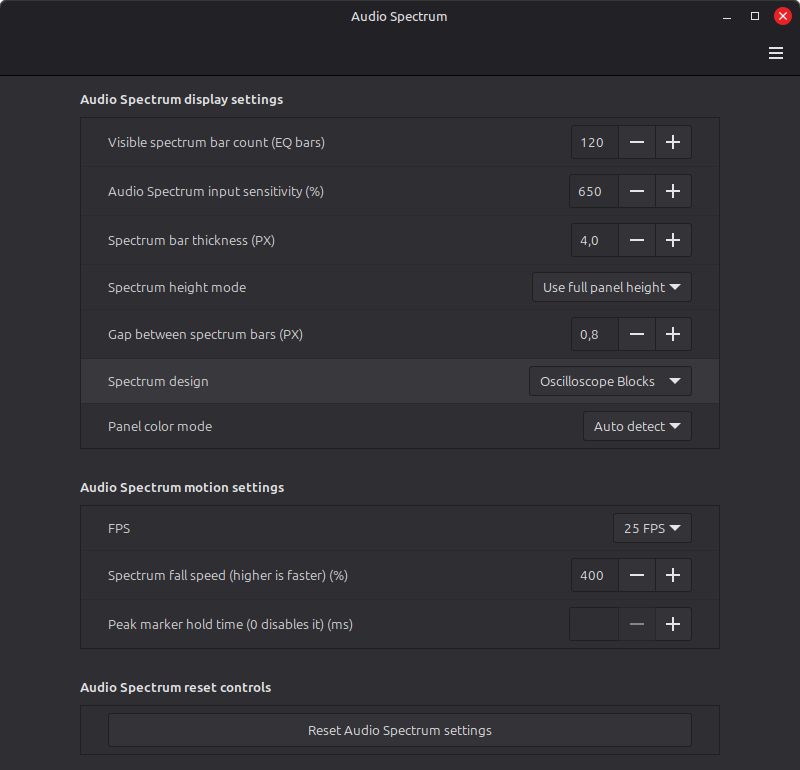

# Audio Spectrum

A real-time system audio spectrum visualizer for the Cinnamon desktop.

Audio Spectrum displays the audio currently playing on your system directly in the Cinnamon panel, with multiple visualization styles and configurable animation settings.

## Features

- Real-time system audio visualization
- Stereo analysis that avoids phase cancellation
- 17 visualization styles:
  - Classic LED
  - 80s Car Stereo
  - Dot Matrix
  - Classic Spectrum
  - Fire
  - Neon Line
  - VU Meter
  - 1980s Digital
  - Oscilloscope
  - Classic Neon
  - Vacuum Fluorescent
  - Amber Analyzer
  - LED Tower
  - Futuristic Dashboard
  - Oscilloscope Blocks
  - Cassette Deck
  - Pixel Plasma
- Adjustable number of EQ bars and audio sensitivity
- Automatic width based on bar count, bar width and spacing
- Automatic panel-height fitting or manually selected visualizer height
- Top, center or bottom alignment in manual-height mode
- Selectable 20, 25, 30 or 60 FPS
- Adjustable fall speed and optional peak hold
- Automatic light/dark panel contrast detection with manual Light and Dark overrides
- Theme-aware outlines and cleaner segmented skins for reliable contrast on light panels
- Restore-defaults button

## Screenshots

### Amber Analyzer

### Cassette Deck

### LED Tower

### Neon Line

### Pixel Plasma

## Requirements

- Cinnamon desktop environment
- CAVA 1.0 or newer (audio analysis backend)
- PulseAudio or PipeWire compatibility through CAVA's PulseAudio input

The Easy Install package checks CAVA and can help install or update it on Linux Mint, Ubuntu and Debian-based systems. When a compatible system CAVA is not available, it can install the tested CAVA 1.0.0 release privately for the current user without replacing the system package.

## Installation

### Easy Install

For the simplest installation, download the Easy Install package from the [Releases](https://github.com/CrazySwede87/audio-spectrum-cinnamon/releases) section.

Extract the archive and run `Install Audio Spectrum.sh`.

The installer checks CAVA and reloads an already active Audio Spectrum applet after an installation or upgrade.

### Manual Installation

Copy `audio-spectrum@crazyswede` to `~/.local/share/cinnamon/applets/`, then add **Audio Spectrum** to the Cinnamon panel through the Applets settings.

## Configuration

Right-click the applet and open its settings to configure the visualization, number of bars, sensitivity, bar geometry, height, alignment, panel color mode, animation speed, fall speed and peak hold.

The **Panel color mode** setting defaults to **Auto detect**, which reads the panel background and applies the appropriate contrast treatment. **Light panel** and **Dark panel** can be selected manually for transparent or customized themes.

### Audio level and visualization height

Audio Spectrum analyzes the audio level produced by the playing application. For the strongest response and full use of the available visualization height, set the volume inside the application—such as YouTube or a media player—to 100%.

Use the system volume to control the actual listening level. Changing or even muting the system volume does not affect the visualization. Lowering the volume inside the playing application, however, reduces the signal received by Audio Spectrum and results in shorter bars.

The **Audio sensitivity** setting can be used to fine-tune the visual response for different applications and audio sources.

## Bug reports and feature requests

Report bugs or request features through [GitHub Issues](https://github.com/CrazySwede87/audio-spectrum-cinnamon/issues).

## License

Copyright (C) 2026 CrazySwede

Audio Spectrum is free software licensed under the GNU General Public License version 3 (GPL-3.0). See [LICENSE](LICENSE) for the full license text.

